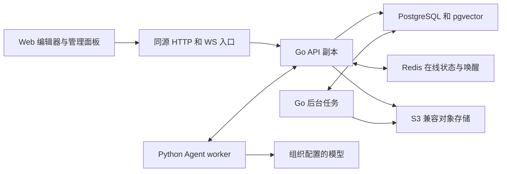
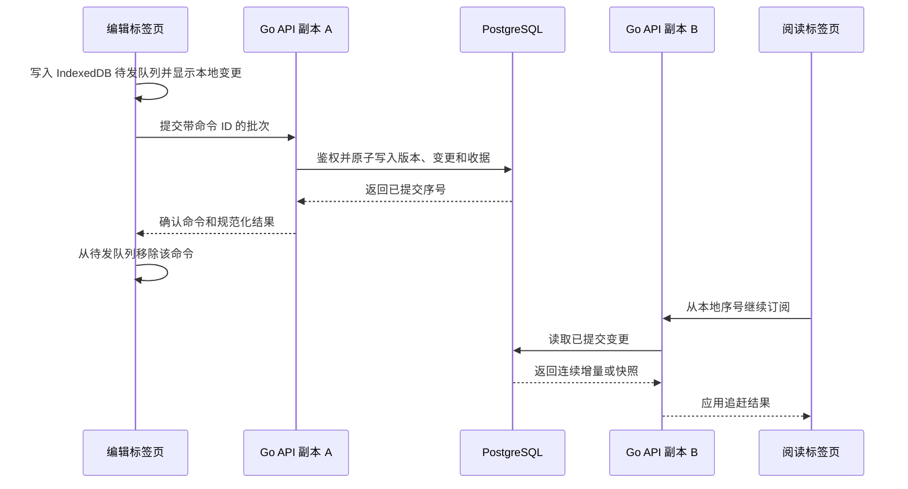
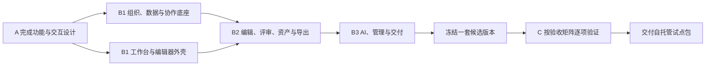

# Shiori 自托管产品化实施计划

## 当前交付顺序 · 2026-11-12

首发面向小团队，以 Docker Compose 交付 Teams、Projects、Boards、Docs、Sheets 和 Slides。首发前需要完成真实主机的 HTTPS/WSS 与协作验收（XW-151），以及异地备份、空实例恢复和切流回滚验收（XW-152）。两项沿用冻结 RC2 和[联合验收清单](docs/guide/pilot-acceptance.md)。实机验收后，再确认最终 Shiori 候选并补测有差异的路径。

I10 知识库、I11 完整管理控制台和 Kubernetes / Helm 放在后续。Meetings 媒体和外部模型按需要配置并单独验证。下文保留 11 月 10 日的原始规格、容量目标和实施记录；其中更广的交付范围以此处的更新为准。

2026-11-10 · 依据本地 `main` 的 `0107faa` 和当前工作树

首版面向自托管的小型团队。主流程是创建工作区和画板、共同编辑、留下评审意见、用 AI 整理或生成内容、保存可追溯版本。组织管理员可以启用云模型，也可以配置本地模型。部署人员用 Docker Compose 或 Kubernetes 交付同一套应用，并能在控制台判断实例是否健康、任务是否积压、备份是否可恢复。

- [首发范围](#scope) · [当前代码](#baseline) · [交互设计](#design) · [技术架构](#architecture)
- [协作和数据](#collaboration) · [AI 与知识库](#agent) · [管理与部署](#operations)
- [迁移](#migration) · [集中实施](#implementation) · [逐项验收](#verification)

## 🎯 首发目标与范围

| 使用者 | 首发要完成的任务 | 可交付结果 |
| --- | --- | --- |
| 团队成员 | 从空白或模板创建白板，邀请同事，进行工作坊 | 有归属、可搜索、可分享和可恢复的画板 |
| 评审者 | 跳转到指定页面或区块，跟随演示，标注意见，稍后回来继续 | 持久评论线程、提及通知、待处理筛选和可复制的定位链接 |
| 会议主持人 | 用自然语言生成会议结构、流程图和便签，把已有便签归类或转成行动项 | 可检查、可编辑、可一次性应用的 AI 草案，依据原文的结果附引用 |
| 组织管理员 | 邀请、改角色、配置分享与 AI 策略、查看审计和资源用量 | 可解释的有效权限，按人和日期筛选的管理记录，以及可执行的恢复入口 |
| 部署人员 | 本地初始化、升级、检查健康、备份和恢复 | 可重复部署的 Compose 包、Helm chart、两副本本地演练和运维面板 |

**首版场景。** 模板先做空白、设计评审、团队复盘和流程图。一个团队可在同一画板中完成便签输入、同步讨论、异步评审、AI 汇总和导出。个人草稿和组织内容有明确归属。桌面端完整编辑，窄屏优先浏览、缩放、定位与评论。以 5–25 人团队为设计假设，部署采用单区域、单逻辑 PostgreSQL 写入端，API 和 worker 可独立增加副本。容量目标见验收部分。

**后续扩展。** 多 Agent 编排、丰富的第三方连接器、SAML/SCIM、插件市场、语音会议、复杂富文本和跨区域双活各自立项。企业身份如成为试点硬要求，可先补标准 OIDC 登录和租户身份映射。

## 🔎 现有项目与改造落点

当前版本已有 React/Vite 前端、Go/Gin API 与 WebSocket、PostgreSQL、可选 Redis 和 MinIO。现有代码含结构校验、部分权限回查、乐观锁、速率限制和少量单测。历史 [ANALYSIS.md](ANALYSIS.md) 基于更早提交。下表对应这次读取的工作树，包含暂存和未暂存改动。

| 区域 | 当前可复用的东西与代码证据 | 本轮改造 |
| --- | --- | --- |
| 工作台 | [App.tsx](app/src/App.tsx#L39) 有登录、`/workplace`、画板和旧链接跳转。[WorkspaceDashboard.tsx](app/src/components/WorkspaceDashboard.tsx#L33) 把工作区分类和画板归组放在浏览器存储 | 组织、工作区、项目成为服务端实体。个人折叠状态继续做偏好，实际归属从 API 读取 |
| 编辑器 | [ShioriCanvas.tsx](app/src/components/ShioriCanvas.tsx#L1609) 用 DOM/SVG 与变换层渲染，已有选区、属性、工具、快捷键和组件。当前排序遍历所有对象，[元素基类](app/src/lib/elements.ts#L54) 无 `pageId`，[usePages.ts](app/src/components/canvas/hooks/usePages.ts#L23) 只改变页面列表与当前页 | 真实页面和区块、视口裁剪、可复用命令、按对象订阅。把客户端当前页从共享文档移到个人视图状态 |
| 分享与评审 | [ShareDialog.tsx](app/src/components/ShareDialog.tsx#L124) 已有邀请、链接角色和成员列表。[room.go](server/internal/model/room.go#L196) 决定 owner、成员和链接访问。[main.go](server/main.go#L99) 的路由覆盖这些操作。当前工作树删除了版本面板，评论角色已有枚举和访问门槛 | 做有效权限展示、邀请接受/过期/撤回、评论线程与版本服务。通过 API 返回能力，所有写入走后端鉴权 |
| 实时保存 | [useCollaboration.ts](app/src/lib/useCollaboration.ts#L88) 已接收 WS 历史，[useAutoSave.ts](app/src/components/canvas/hooks/useAutoSave.ts#L74) 仍独立保存整板。[ShioriCanvas.tsx](app/src/components/ShioriCanvas.tsx#L277) 的冲突回调载入远端状态。[client.go](server/internal/ws/client.go#L292) 持久化操作出错后仍走广播 | 一条可恢复的提交路径。按服务端序号追赶，收到数据库提交确认才显示已同步。替换 HTTP 与 WS 各自写入的模式 |
| 多实例和离线 | [hub.go](server/internal/ws/hub.go#L119) 通过 Redis 转发，慢连接可能丢消息或被移除。[websocket.ts](app/src/lib/websocket.ts#L137) 重连时先发送内存待发消息，再重入房间，协作层会跳过断线时的操作和同一账号发来的更新 | 连接身份细化到设备与标签页。IndexedDB 持久保存待发命令，恢复会话后重放。Redis 转发丢失由 PostgreSQL 补齐 |
| 文件与导出 | [ShioriCanvas.tsx](app/src/components/ShioriCanvas.tsx#L637) 的客户端 PNG 把多种对象画成矩形，JSON 缺少页面。[export.go](server/internal/handler/export.go#L101) 的后端 JSON 从操作表生成。图片上传有 Data URL 路径。文件信息用示例时间和大小 | 同一版本生成 PNG 和可重导入的项目包，资源按引用管理。文件信息展示真实创建人、修改时间和版本 |
| 发布与维护 | [Dockerfile](Dockerfile) 分开编译和拷贝前端，Go 静态资源有 embed 与磁盘回退两种路径。[docker-compose.yml](docker-compose.yml) 使用固定容器名、示例凭据和 `minio:latest`。[main.go](server/main.go#L26) 在进程启动时迁移，现有 GitHub Actions 为文档发布 | 可复现的应用镜像、独立迁移任务、Compose 与 Helm、应用 CI、健康探针、优雅退出和运维控制台 |

**界面读屏。** 用当前源码和合成 API 数据在 1280 × 720 浏览了登录、工作台、编辑器与分享对话框。工作台重复显示分类，每张卡片同时铺开打开、重命名、删除和移动。编辑器网格占据过多视觉注意力，分享弹窗用了缺少定义的 `--surface-panel`，底下的文字和网格穿透弹窗。该预览用于界面设计取样，真实鉴权、多人同步、备份及部署属于实现后的验收。

## 🎨 产品界面与交互规格

### Figma 与 FigJam 的参考点

FigJam 适合对照白板工具、区块定位、跟随演示、评论和基于自然语言的白板生成。Figma Design 的图层与右侧属性面板用于对照复杂对象编辑，命名版本和管理员活动日志用于对照历史与治理。Shiori 的差异化设计是部署状态直接可见、模型运行范围明确、AI 草案与正式画板提交之间有清晰交互。[^figjam][^figma-inspector][^figma-follow][^figma-version][^figma-ai][^figma-audit]

### 页面与面板

| 页面 | 布局与主要动作 | 状态与反馈 |
| --- | --- | --- |
| 安装与登录 | 首次部署向导呈现实例配置、首个组织和管理员、登录方式。普通成员从邀请链接直接进入目标工作区或画板 | 初始化、邀请过期、账号不匹配、会话到期、服务暂不可用。每个错误给出对应恢复操作 |
| 文件浏览器 | 左侧组织切换、最近使用、收藏、与我共享、工作区和项目。中间可切换网格和表格，含真实缩略图、归属、更新时间和权限。顶部全局搜索及新建 | 服务端分页、搜索范围和筛选条件可见。整卡打开，次级操作进菜单。移动显示目标和权限影响。归档可恢复 |
| 白板编辑器 | 顶部 48 px 放返回、面包屑、同步状态、成员与分享。左栏约 240 px，容纳页面、区块/对象树和搜索。底部浮动工具栏保留选择、手形、便签、绘制、文本、连接线、区块与插入。右栏约 336 px，按当前操作切换属性、评论、历史与 AI，AI 工作状态在收起后继续显示 | 启动时使用上次选择的侧栏。无选中时显示画板选项，单选按类型显示属性，多选显示公共字段、混合值和对齐。支持聚焦模式、跳到选区、适配内容和小地图 |
| 分享与协作 | 实底对话框显示邀请、有效权限、可撤销链接和成员。顶部头像展开后可跳到用户、发起自愿跟随或退出演示。评论入口连接对应区块 | 登录前后的权限差异、编辑降级、请求访问、撤销链接、等待邀请接受都有明确反馈。分享默认邀请权限为查看，可手动提升 |
| AI 面板 | 上方显示任务与上下文范围，中间显示运行过程、生成预览和引用，底部放取消、重试、修改和应用按钮。画布显示草案轮廓、将插入的区域和对象数量 | 排队、生成、需要补充、预览可用、权限变化、对象过期、额度不足、服务不可用均有独立状态。应用后聚焦新内容并显示撤销入口 |
| 管理控制台 | 与创作界面共用色彩与控件，按实例或组织权限显示相应导航。首页只显示需要行动的健康、成员、任务、备份及配额信息 | 列表支持搜索、筛选、详情、执行人、最后更新时间和状态原因。图表给出时间窗口、单位及对应表格 |

### 视觉、动效与输入

- 深浅两套主题共用语义 token。界面使用 Geist，运维数值与短 ID 使用 IBM Plex Mono，中文使用系统 CJK 回退。亮色画布接近 `#F6F7FA`，暗色画布接近 `#12151D`，主操作和选框使用蓝紫色。高饱和颜色主要服务选区、协作者与有意义的状态。分享、权限和错误弹窗使用实底，点阵随缩放调整密度和对比度。
- 点击、切换和工具反馈建议 120–160 ms，侧栏和对话框 180–240 ms。拖动、绘制、缩放采用逐帧更新，远端指针使用有限插值，AI 草案出现用短淡入和描边。系统启用减少动态效果时，关闭位移、弹跳、脉冲和自动镜头过渡。
- 键盘覆盖导航、对象选择、移动、对齐、评论、面板切换与命令搜索。弹窗打开后接管焦点，关闭后还给触发控件。屏幕阅读器通过可导航对象树读到对象、区块、评论和选中状态。把错误、同步与只读状态用文字和图标一起表达，以 WCAG 2.2 AA 为界面验收目标。[^wcag]
- 桌面优先验证 1280、1440 和 1920 px，平板采用单侧面板和触控缩放，手机使用底部抽屉显示评论和目录。Pointer Events 统一鼠标、触控和笔的捕获与取消。中文输入法组合态忽略全局快捷键，快捷键在 macOS 与 Windows/Linux 分别显示正确修饰键。

### 白板、评审和导出的功能定义

| 能力 | 首版应有的完整行为 |
| --- | --- |
| 页面与区块 | 增删、排序、命名、复制、搜索、生成定位链接。跨页移动检查父子关系，复制重映射内部连接线。删除可恢复并对锚定评论显示原位置或归档状态 |
| 常用对象 | 便签、文本、形状、线/箭头、手绘/橡皮、图片、区块和印章支持选择、框选、对齐/分布、吸附、层级、锁定、分组、复制粘贴。连接线绑定对象锚点。缩放后命中测试、属性和选框一致 |
| 工作坊组件 | 表格用稳定行列和单元格 ID。看板用可排序卡片 ID。计时器共享开始时间与结束时间，暂停/继续由命令更新。投票/点投在服务端验证参与资格和每人额度。给现有复盘、秒表、情绪、随机选择、问答和反应组件做兼容渲染，并逐个确定可编辑状态和数据迁移规则 |
| 评审 | 查看者浏览。评论者可以建线程、回复和提及。编辑者编辑对象。线程可按未解决、已解决、提及筛选。评论锚定页、对象或坐标。离线时可写草稿，提交后服务端校验角色并发出站内通知，可配邮件 |
| 版本 | 自动检查点提供时间和参与者，显式命名版本支持预览、复制为新板与恢复。恢复创建新版本，保留评论与审计，可一键回到恢复前检查点。版本和对象状态有可对照的序号 |
| 文件 | 私有资产上传有进度、取消、错误重试和独立引用。导出选区、页面或全板，PNG 忠实渲染可见对象、文字和图片，长图超限给出分区导出。版本化 JSON/ZIP 可按说明重导入，包括页面、对象、引用资产及格式版本 |

## 🧱 技术路线

**保留 React、Go 和 PostgreSQL，重做编辑器的文档层与协作协议。** 当前投入最大的改动发生在文档语义、权限、状态一致性与交互。现有语言和框架可以承担这些工作。为 AI 引入 Python 进程，为分布式交付引入明确的运行角色和可恢复的存储协议。

| 层 | 首版选择 | 采用条件与替代路线 |
| --- | --- | --- |
| 前端 | React、TypeScript、Vite、Tailwind、React Router。用 Radix UI 的可访问原语建设共享控件，TanStack Query 管理列表和服务端缓存，编辑器订阅本地文档仓库 | 现有组件按命令和领域拆分。对画布做 DOM/SVG 视口虚拟化，游标/网格隔离，拖动保留本地临时状态。完成同一大板基准后，再比较 Canvas 2D/Konva 的渲染层替代。Excalidraw 可作嵌入对照，tldraw 需要先核实生产授权。[^excalidraw][^tldraw] |
| 应用服务 | Go/Gin、pgx、WebSocket，按组织、权限、文档、协作、作业、资产、管理分模块。单代码库提供 `api`、`worker`、`migrate` 三个运行角色 | 从入口拆开配置、迁移、生命周期和路由。HTTP 用 OpenAPI，命令/事件用版本化 JSON Schema，生成 TypeScript 与 Python 类型，并用共享样本测试 Go、TS 解析的一致性 |
| 同步 | Go 服务端串行分配画板内序号，Postgres 原子提交，浏览器乐观更新与离线队列 | 编辑对象和批量 Agent 草案需要细粒度授权、审计和冲突规则。Yjs 支持可交换、可重放的更新，可在引入多人富文本或长离线编辑时验证在局部字段使用。届时先明确授权、历史、存储和迁移边界。[^yjs] |
| 存储 | PostgreSQL 事务数据和任务队列，pgvector 提供可选 RAG 扩展。Redis 用于在线状态、短期缓存和跨实例唤醒。S3 API 对象存储保存资产与导出 | 新本地环境使用锁定版本的 SeaweedFS S3，现有 MinIO 通过兼容配置读写与迁移。MinIO 社区源码仓库已停止维护，现有 `latest` 镜像引用在新部署配置中替换。对象存储做实际能力验收。[^pgvector][^redis][^seaweedfs][^minio] |
| AI | 可选的 Python/LangGraph worker，基于同一模型接口接入 OpenAI 和 Ollama。编排定义固定状态、检查点和有限重试 | LangChain 的适配器按需采用。AutoGen 官方项目已归档。更多模型、框架和工具通过相同的任务、输出验证和用量接口接入。[^langgraph][^autogen][^openai][^ollama] |
| 运行 | 一个同源 Web 入口，容器镜像固定依赖与基础镜像，Compose 与 Helm 使用同一镜像和配置 schema | 开发代理、单机、集群共享 REST/WS 入口。文档、任务和权限持久化后，API 与 worker 可以独立扩容 |

**代码落点。** `app/src` 内建设工作台、编辑器、管理和 AI 模块，拆开领域状态、视口渲染、面板状态。服务端新增文档、权限、组织、作业、迁移模块，在独立的 `agent/` 保存 Python worker 与模型契约。公共协议放入 `contracts/`，交付配置放入 `deploy/`。命令总线处理菜单、工具栏、键盘与 AI 应用，渲染层和 HTTP 层使用同一版本的对象定义。

## 🔄 协作、一致性与访问控制

### 数据模型与写入契约

| 实体 | 关键约束与用途 |
| --- | --- |
| `organizations`、`workspaces`、`projects`、`boards` | 每个画板明确归属组织与项目，保留现有画板 ID。成员、邀请、项目访问和分享链接有独立记录。跨组织外键或同等数据库约束约束资源关系 |
| `board_heads`、`board_pages`、`board_elements` | 每板维护 `head_seq`、`epoch`、协议版本。对象带 `page_id`、稳定 ID、父区块、顺序键、对象和字段版本。页面、区块、元素和资产引用由服务端校验 |
| `board_changes`、`command_receipts`、`board_snapshots` | `(board_id, seq)` 唯一。收据以画板、客户端和命令 ID 去重，并包含提交范围与摘要。同一命令 ID 携带不同内容时返回冲突。快照记录序号和规范化哈希 |
| `comment_threads`、`comments`、`board_versions` | 线程锚点含页、对象或坐标，存作者和状态变更。命名版本引用检查点。恢复只重建文档对象，评论继续可查，失效锚点显示原页面信息 |
| `outbox`、`jobs`、`audit_events` | 文档写入和需要发送的事件同事务落库。后台作业记录状态、执行次数、租约和结果引用。权限变更、恢复、导出和 Agent 应用写入审计 |

命令批次携带 `protocolVersion`、`boardId`、`epoch`、`clientId`、`commandId`、`baseSeq` 和类型化操作。需要冲突检测的操作还带对象/字段版本。服务端从会话取得操作者，在同一事务内锁定画板头、校验当前权限和对象引用、分配连续序号、落文档状态、变更记录、收据和 outbox。确认消息包含已提交的序号范围和规范化结果。查询或事务失败返回可重试错误，客户端保留待同步命令。拖动和画笔预览在本地逐帧更新，跨端预览可限频，拖动结束或有限分段才提交持久写入。[^outbox]

### 加入、断线、重连

1. **打开画板。** 服务端在一致读视图内返回快照和序号 `S`。WS 订阅先注册唤醒，再捕获高水位 `H`，分页读取 `(S,H]`。缓冲同期通知，追赶到高水位后读取更晚的提交。序号缺口、重新订阅、Redis 恢复和定期对账都从 Postgres 补齐。追赶窗口被压缩时返回重新取快照指令，客户端在新快照上重放仍合法的待发命令。
2. **编辑与落盘。** 客户端采用带分组的乐观更新，写入浏览器待发队列后显示“已保存在此设备”。只有提交确认或补读到对应收据后显示“已同步”。同一账号不同标签页使用不同的连接身份，并按命令 ID 去重。同一命令可经 WS 重发，HTTP 降级走同一个服务端处理器。
3. **暂时离线。** 已打开且组织允许离线的画板可继续编辑便签、文字、对象位置和基础形状。权限变更、分享、云端 AI、导出和恢复历史需要在线。客户端按账号、组织、画板和设备隔离缓存。个人视图状态与文档分开。重连先重新鉴权和追赶，再把待发命令按原顺序送出。
4. **离线容量。** 首版建议每板待发 32 MiB 或 5,000 条命令，每个账号在该浏览器的缓存总量 128 MiB，离线授权期最长 7 天，均为可评审初值。先清理已确认快照的冷缓存，待发内容达到上限时停止接受更多离线写入并给出同步入口。主动登出时若有待发命令，提供先同步或确认退出的选择，退出后清理缓存。收到撤权或离线授权到期时关闭受影响的文档并清理缓存。组织可关闭离线缓存，已落在设备上的副本仍受设备与浏览器约束。
5. **故障和背压。** 连接状态区分正在连接、追赶、在线、离线、冲突与访问失效。Redis Pub/Sub 只负责唤醒与可丢弃的光标/视口事件。在线状态按连接 ID 和心跳 TTL 管理，同账号多个标签页合并展示。慢客户端丢弃过期光标帧，持久事件积压则通知重同步或关闭连接，禁止静默丢失。Redis 故障时用有抖动的按活跃画板聚合补读，限制数据库压力。[^redis]

### 冲突与恢复规则

| 冲突 | 首发处理 |
| --- | --- |
| 不同对象或同对象不同字段 | 合并兼容字段。位置、尺寸和旋转按操作语义定义原子字段组，防止一半坐标来自不同用户 |
| 同一对象的位置同时变化 | 以服务端提交顺序确定位置，拖动时可显示其他人正在操作的提示 |
| 同一便签文本同时或离线修改 | 按文本版本检查。相同基础版本后的第二份内容进入冲突面板，展示当前内容和本地内容，可选择编辑合并、保留草稿或放弃本次变更 |
| 删除与编辑、页面已移走 | 以墓碑和对象/页面版本判断。旧写入返回结构化冲突，客户端定位到可恢复的位置。只有仍具相应权限时才开放另存 |
| 撤销、重做 | 按发起人及操作组生成逆向命令，检查目标受影响字段是否仍处在可撤销状态。远端操作继续显示，冲突时提供可撤销范围和原因 |
| 版本恢复 | 保存恢复前检查点，再提交恢复事务并提升 `epoch`。旧 epoch 命令须重新预览并提交。锚定的评论与审计仍可浏览 |
| 日志压缩 | 定时以已提交序号保存校验快照，校验后裁剪超期增量。命名版本单独保留，旧客户端走快照恢复。去重收据的有效期覆盖离线授权期，过期的设备授权下的重放请求明确拒绝 |

### 角色、租户和接口

- **实例角色。** 实例操作员负责设置、健康、备份和升级。运营权限默认只读取脱敏的实例状态和汇总指标。内容访问沿用画板成员授权。
- **组织角色。** Owner 可移交所有权、管理管理员和组织策略。管理员管理成员、工作区、审计、模型与额度。成员可以在被授权的工作区建立项目或画板。访客凭针对项目或画板的授权进入。最后一个 Owner 必须先完成移交。首装默认邀请注册，可配置邮件找回和组织登录策略。
- **画板角色。** 有效角色为 Owner、编辑、评论、查看。先应用组织策略上限，再计算项目、显式成员和链接授予的角色。明确降级优先于继承授予。默认仅具名邀请。组织可开启仅本组织可用的链接，也可开启允许已登录持有者访问的链接。链接支持过期与撤销，仅授予目标板的查看或评论权限。具名邀请可授予编辑。有效权限返回授予来源和策略说明。
- **鉴权一致性。** 浏览器用同源 HttpOnly 会话 Cookie、生产 TLS、明确的 Origin 与写操作 CSRF 防护。用服务端时间与会话状态控制过期和注销，退出后撤销活动连接。去掉浏览器长期 bearer 和 WS 查询会话 token。API、WS、搜索、资产下载、后台作业、AI 检索和应用都检查组织、资源和当前角色。写入权限在事务内重新判断，在线连接收到撤权通知后重置内容订阅，事件发送前仍按当前权限检查。
- **接口草图。** `GET /api/v2/boards/{id}/snapshot`、`GET /api/v2/boards/{id}/changes?afterSeq=...`、`POST /api/v2/boards/{id}/commands`，以及 `/ws/v2` 的 `subscribe`、`catchup`、`commit`、`ack`、`presence`、`resync_required`。评论、命名版本、分享、恢复有显式端点，返回稳定错误码、可重试标记和请求 ID。服务端用 `capabilities` 表达 UI 可用操作。

首发画板权限按下表定稿，组织策略可以收紧导出、链接与 AI。管理界面把“移除这项授权”和“禁止此用户访问”作为有明确影响提示的动作，有效权限解释仍存在的项目或链接授权。

| 画板操作 | 查看 | 评论 | 编辑 | Owner |
| --- | --- | --- | --- | --- |
| 阅读、定位、跟随和查看评论 | ✓ | ✓ | ✓ | ✓ |
| 创建线程、回复、编辑自己的评论 |  | ✓ | ✓ | ✓ |
| 编辑对象、命名版本、发起及应用 AI 草案 |  |  | ✓ | ✓ |
| 管理成员和链接、恢复旧版本、归档画板 |  |  |  | ✓ |

## 🤖 AI Agent、模型与知识库

### 第一批可交付工作流

| 工作流 | 用户输入 | 预览与应用 |
| --- | --- | --- |
| 生成会议板或复盘板 | “给 8 人团队做 45 分钟复盘，最后留 10 分钟定行动项” | 产出标题、分区、时间提示、便签和行动项表。可调整结构后插入当前页或新页 |
| 生成流程图 | “画出从需求评审到发布的流程，标出验收失败回路” | 产出有节点、边和标签的结构，由确定性布局生成可编辑形状与连接线。应用前展示目标区域和碰撞提示 |
| 归类便签和总结行动项 | 选中便签或评论区块，选择归类、总结或提取 | 保留原便签，可预览新增分区和摘要。移动原便签要由用户显式选择，展示移动清单。行动项标注依据、待确认负责人和时间 |
| 知识库问答与生成 | 选择项目知识源，要求回答或把结果变成画板内容 | 返回带原文定位的答案，允许插入引用卡片或结构化草案。缺少依据时展示缺口并允许缩小或重新选择范围 |

### 编排、预览与落板

1. **创建运行。** 从选区或面板启动，显示组织、画板、所选对象/页面、知识源和具体模型。默认仅取选中对象。用户主动扩大范围，云端模式明确标注哪些内容和查询会发给配置的服务。后端校验 `run_ai`、读权限、目标板编辑权限、额度和组织策略，持久化 `run_id` 与输入版本引用。
2. **执行。** LangGraph 节点依次判断任务、加载授权上下文、按需检索、生成结构化输出、校验和保存预览。对缺少参数的任务支持一次明确澄清，用户稍后可继续。用按运行隔离的检查点恢复，保存外部调用结果和用量，限制节点调用、超时、工具集合和重试次数。worker 通过内网认证接口读取本次任务所需的数据，画板写操作由 Go 应用服务受理。[^langgraph][^langgraph-interrupts]
3. **流式状态。** 任务状态为 `queued → running → needs_input/preview_ready → applied`，另有 `cancelled`、`failed`、`expired`。以 SSE 推送阶段和预览摘要，事件带单调 ID 并支持 `Last-Event-ID`。回退到轮询仍可显示状态。预览发布前完成权限和输出校验。关闭面板或浏览器后可从任务列表找回。取消运行停止接收后续输出，并在可行时取消供应商请求。
4. **结构化草案。** 模型只返回符合 JSON Schema 的 `BoardProposal`，包含草案目标、区域/节点/边、来源引用及变更意图。Go 校验类型、节点数量、字符串长度、页与对象引用、合法字段和总大小。用稳定 ID 和确定性布局生成预览所用的命令。未支持的类型进入错误状态，最多一次结构修复。文档、便签和模型输出都是数据，只有预先定义且受权限限制的检索和提案工具可用。
5. **用户应用。** 用户可以编辑草案，随后以 `proposalId + version` 提交。服务端重查发起人权限、组织策略、知识源访问和输入依赖版本，源内容已变化时要求刷新草案。无关改动允许继续应用。有效草案作为一组文档命令原子提交，生成版本引用和审计项，其他在线用户随后收到。相同应用请求返回相同结果，撤销也走常规命令路径。

建议端点为 `POST /api/v2/boards/{id}/agent-runs`、`GET /api/v2/agent-runs/{id}`、`GET /api/v2/agent-runs/{id}/events` 以及 `answer`、`cancel`、`retry`、`apply` 操作。Go API 持有任务状态和授权，Python worker 持有图节点检查点。两者通过运行 ID、工作租约和单调事件序号对齐。提供确定性模型替身，覆盖完整工作流和故障注入。

### 模型配置、RAG 与治理

- **提供商。** 首发接入 OpenAI 和 Ollama，统一 `generateStructured`、`embed`、`health` 和用量接口，按配置识别生成、嵌入、上下文窗口和输出能力。组织默认 AI 关闭。管理员可启用云端或本地配置、测试连通性、设置允许模型和额度。Ollama 仅连接显式配置的本地运行端点，外部调用受目的地策略限制。测试连通性使用独立的合成数据。[^openai][^ollama]
- **知识源。** 先接入授权画板的便签/标题/评论文本，以及项目上传的 TXT、Markdown 和含文本层的 PDF。显示待索引、处理中、就绪、过期、失败原因和重建进度。入库键含组织、来源、内容版本和嵌入模型指纹。通过分批作业和内容哈希避免重复嵌入，索引可重建。文件解析限制类型、大小、页数和执行时间。扫描版 PDF 后续可单列 OCR。
- **检索。** 对授权来源先做组织与资源范围约束，再进行关键词和向量召回，返回带段落、页码或对象坐标的引用。起步使用 pgvector 的精确检索，按数据规模测是否需要近似索引。为中文使用支持 CJK 的切分，保留源版本。检索结果和最终引用按当前权限复核，撤回或删除的源立即从可查询范围退出，并异步清理旧索引。[^pgvector]
- **数据范围和成本。** 分别开关云生成、云嵌入和本地模型，管理员可按组织设并发、单次上下文上限、每日/月额度和硬停止。云生成运行使用用户确认的范围，项目批量云嵌入需要相应知识源的独立授权。密钥仅在服务端以 Secret 引用或加密形式保存。运维面板可查看模型、耗时、用量、发起人、状态和错误类别。
- **运行留存。** 对完成任务，默认审计保留 ID、模型、范围、状态和用量等元数据。恢复所需的最小中间状态加密保存并按 TTL 回收，组织可配置是否保留可见的运行历史。发给模型的全文、密钥和会话令牌从日志、指标和支持包中排除。供应商遇到超时且结果未知时标记待确认，只有具备安全重试条件时自动重试。

## 🛠️ 管理控制台与部署

### 管理控制台

| 区域 | 用户在面板上能看到什么 | 可执行动作 |
| --- | --- | --- |
| 实例概览 | 版本、部署方式、数据库和对象存储就绪度、Redis 和模型降级、最近备份、待处理事项 | 进入有问题的组件详情，复制诊断 ID，下载脱敏诊断包 |
| 安装与配置 | 域名、TLS、注册策略、数据库/Redis/对象存储连接、邮件、AI 可用性、迁移状态 | 一次性初始化、校验配置、生成 Compose/Helm 配置示例，显示必须由部署人员在终端或 GitOps 执行的命令。密钥位置和配置来源可见，值做遮蔽 |
| 人员与组织 | 组织、工作区、项目、成员、邀请、角色、最后活动、有效权限 | 邀请、改角色、撤回邀请、移交所有权、挂起访问和恢复，记录影响范围和审计 |
| 内容与分享 | 项目/画板归属、归档状态、成员权限来源、链接范围和过期时间、存储用量 | 移动、归档、恢复、撤销链接、配置访客和离线策略。按当前角色展示内容 |
| 模型与知识库 | 云端/本地提供商配置、模型能力、连通性、额度、索引状态、运行队列和错误分布 | 启停、测试、轮换密钥引用、限制模型及上下文、重建索引、取消运行、重试符合条件的失败任务 |
| 运行与任务 | 在线连接、按实例分布、同步延迟、重连与积压、队列最老任务、各 worker 最近心跳 | 切换时间窗、筛选状态、查看任务链路、按权限取消/重试。用表格读数支持图表 |
| 备份与升级 | 数据库与资产备份清单、校验结果、恢复时间点、迁移记录和当前兼容版本 | 创建备份、导出校验清单、发起恢复演练。实际数据库恢复与集群变更由部署人员执行，面板显示进度与结果 |
| 审计与保留 | 操作者、时间、组织、动作、资源、结果、请求 ID。区分人、作业和 AI 申请者 | 按维度过滤、分页、导出 CSV，管理保留期。对权限变更、数据导出、恢复和密钥轮换给出关联记录 |

首次管理员用 CLI 生成短时一次性初始化凭据，成功后实例进入已初始化状态。控制台用 Go 管理 API 操作应用数据，集群改动通过受控的部署配置和 CLI 完成。普通组织管理员只看到所属组织的指标、资源和审计。实例操作员得到健康与调度视图。前端的状态、图表和行动入口接同一真实 API。

控制台顶部始终显示当前实例或组织、环境和最后刷新时间。桌面概览将实例健康、待处理作业和备份放在第一屏，连接、同步延迟和 AI 用量用小型趋势图显示，底部是可筛选的待办事件。点击异常卡片直接进入对应时间窗和过滤条件。列表将详情展开为侧栏，保留当前筛选和分页。窄屏以卡片与抽屉呈现同样的关键操作。每个健康状态都能区分成功、降级、失败和数据过期，依赖不可用时保留上次采样时间和可用的诊断入口。

实例端点使用 `/api/v2/admin/instance`，组织设置使用 `/api/v2/orgs/{orgId}/admin`。健康读接口返回依赖、状态、采样时间和诊断码。审计和任务列表使用游标分页。取消、重试和备份创建返回可追踪的任务 ID。实例数据库不可用时，部署人员从探针和容器日志读取诊断。

### 异步任务与观测

- **作业状态。** 导出、缩略图、通知、索引、备份和 AI 使用持久队列。创建作业与业务状态同事务提交，使用唯一业务键去重。消费者以 `FOR UPDATE SKIP LOCKED` 领取，持有带到期时间和代际令牌的租约。长任务续租，更新和提交结果需匹配当前令牌。进程重启后回收过期租约。[^pg-lock]
- **失败处理。** 区分排队、执行、等待用户、成功、取消、失败、重试耗尽。有限指数退避和抖动，按组织限制并发，超时后记录重试理由。输出以作业 ID 和内容校验值关联，避免重复文件或多次写板。SMTP 与模型这类外部副作用使用供应商幂等能力或明确记录结果未知。
- **数据边界。** 资产上传分为授权、上传完成校验与登记引用。只引用已校验的私有对象，下载经当前权限检查。导出固定在特定已提交序号，按需存产物并按 TTL 回收。Go worker 调度渲染，以同一只读渲染层实现 PNG、缩略图和打印视图，避免编辑器和导出分别维护对象绘制逻辑。
- **观测。** 用 OpenTelemetry 贯通 HTTP、WS 命令、任务、AI 调用和资产链路。结构化日志保留请求和运行 ID。指标覆盖服务延迟、提交与广播延迟、序号缺口、补读次数、队列等待、重试、恢复时长、存储和模型用量。用低基数维度聚合，具体画板与运行查受控日志或详情。为积压、数据库不可用、备份过期和磁盘阈值提供面板告警。

### Docker Compose、Kubernetes 和云迁移

| 形态 | 交付内容 | 预期操作 |
| --- | --- | --- |
| Docker Compose | `compose.yaml` 和配置示例，包含 API、Go worker、PostgreSQL、Redis、对象存储与独立迁移任务。AI、Mailpit 和观测按 profile 启动。默认仅暴露 Web 入口 | 初始化、打开页面、建组织、启停 AI、按卷保留数据、原位升级、生成备份、以新实例恢复 |
| 本地 Kubernetes | `deploy/helm/openjam`、`values-local.yaml`、kind 配置和故障演练脚本。kind 多节点验证两个 API 副本、独立 worker 和同源 Web/WS 入口。本地镜像可直接装载到节点。Gateway API 接入实际支持 WS 与 SSE 的控制器 | 渲染并校验 Helm，启动迁移 Job、部署副本、验证 WebSocket/SSE，滚动升级，替换 Pod，关闭 Redis 后继续补读，从备份恢复到新命名空间。[^kind][^gateway] |
| 云端部署映射 | EKS 可换用 RDS PostgreSQL 与 S3，GKE 可换用 Cloud SQL PostgreSQL 与经同一套测试的 S3 兼容对象服务。Redis、TLS、Secret 和身份通过 Helm values 选择外部服务。需要原生 GCS 时先实现并验收该存储适配器 | 编写可迁移配置与操作说明。本地验证配置替换和应用行为，实际云 IAM、数据库扩展、负载均衡、对象签名和故障切换留待真实环境演练 |

- **构建与镜像。** Pin 应用、包管理器、基础镜像和配套服务版本，维护镜像和协议版本对应表。统一前端构建进入 Go 镜像的资源路径，以全新 checkout 和多架构构建验证深链接。运行镜像使用非 root、最少权限、可写目录限于必要路径，生成 SBOM 和依赖报告。CI 构建前端、Go、可选 Python 和镜像。
- **启动和退出。** 迁移用版本化 SQL、独立 Job 和互斥锁，API 启动时检查 schema 兼容。提供 `/livez`、`/readyz`、`/startupz` 和管理端依赖状态。关键数据库失联影响就绪，Redis 或模型失联进入功能降级。滚动更新先摘流量，显式关闭或迁移既有 WS，允许客户端按已提交序号重连。集群部署设置资源请求/限制、PodDisruptionBudget、拓扑分散和经过本地验证的 NetworkPolicy。[^probes]
- **配置与存储。** 数据库和对象服务默认只在私网。会话、对象密钥和模型密钥使用部署 Secret。部署预检检查 DNS/TLS、回调 URL、WS 升级、超时、对象上传与下载、剩余空间和 schema 版本。Kubernetes 本地策略演练使用能够实际执行 NetworkPolicy 的 CNI。对象存储验收覆盖完整上传、范围读、清理、校验和恢复。
- **备份与恢复。** Compose 使用定时逻辑备份，记录数据库快照中引用的不可变对象及校验值，保留这些对象直至备份到期。建议默认每日备份与明确的保留期。PITR 配置同时保留连续归档窗口中的对象版本。恢复先写入新实例或命名空间，比对画板序号、权限、索引任务、引用和对象哈希，确认后切换流量。按实际配置显示可恢复时间点和演练耗时。
- **本地预算。** 实施时为每轮容器演练登记 Compose 项目、kind 集群、镜像、卷、端口和缓存路径。初值为单轮自有临时构建与镜像合计 20 GiB，启动前实际可用空间至少 35 GiB，运行中保留至少 20 GiB。预估会越限时先清除已确认自有且停用的阶段产物或缩小环境。分别记录逻辑大小、分配空间和 APFS 可用量。清理前核对进程、打开文件、归属与计划哈希，保存中断收据。保留最小日志和证据，按现有删除规则处理可回收项。数据卷与共享镜像保持按归属管理。

## 📦 迁移、兼容与回退

1. **建立清单。** 用隔离数据库副本盘点用户、画板、成员、分享设置、`rooms.board_data`、`operations`、图片 Data URL 和对象存储引用。生成逐板数量、规范化摘要和损坏分类。为老画板、空板、缺页、未知组件、图片、大文档和冲突历史制作脱敏固定样本。记录生产迁移脚本及执行计划哈希。
2. **转为 V2 文档。** 以旧系统用户可见的已保存快照作为初始投影。旧表的时间字段可被多种写入改变，只有能证明边界的尾部操作才自动合并。来源不确定时保留原始记录和一个待复核的恢复副本，在报告中列出差异，避免重放整段历史造成覆盖或复活。缺页元素进入首个有效页面。未知组件保留原始数据和兼容视图。内嵌图片按哈希迁移到对象存储，并在核对内容和引用后写入新文档。
3. **转组织与权限。** 已有画板放进所有者的默认工作区并保留画板 ID、所有者、具名成员和评论/编辑授权。历史浏览器分类允许登录后选择导入，经所有权校验后转为项目或个人偏好。对现有开放编辑链接在迁移报告中逐条列出，保留限期的旧行为并提示所有者改发具名邀请。新链接按组织策略生成独立、可撤回的凭据。旧 `/board/:id`、`/room/:id` 和 `?room=` 导航继续定位原板。
4. **切换。** 先采用扩展式迁移增加新表和字段，幂等回填并重复校验。按组织短暂暂停旧写入，排空活动请求，补齐冻结时的增量，检查权限、内容、附件及可重导入导出后切换读写。进入 V2 的板拒绝旧版客户端写入并提示更新。先用合成和脱敏样本演练，再决定可迁移的实际画板批次。
5. **回退。** 切换前可恢复到旧读写。V2 接受写入后用兼容 V2 的上一版镜像回退，保留全部已提交数据。需切回 V1 时先暂停写入并按已演练的转换流程导出 V2 变更，标明不可逆字段的人工恢复办法。原始备份和兼容窗口依据运营保留策略保留，清理独立执行。

## 🗺️ 集中实施顺序

### A. 一次完成产品与技术设计

| 工作包 | 产出与退出条件 |
| --- | --- |
| D01 场景和功能 | 定稿新建→分享→共同编辑、评审→处理评论→恢复版本、AI→预览→应用、部署→组织管理→恢复四条流程。为每条定义角色、成功、空态、错误和恢复 |
| D02 交互与视觉 | 产出登录、文件浏览器、编辑器、分享、AI 与管理员页面的高保真稿及状态对照。统一密度、图标、主题、断点、焦点、动效、键盘和触摸规则。用组件样例对照合成画板 |
| D03 数据与权限 | 定稿 ER 模型、ACL 决策表、V2 协议与命令样本、冲突处理、离线授权、备份一致性和旧板回退。为所有资源标明组织边界与读写路径 |
| D04 AI 与运营 | 定稿 `BoardProposal`、LangGraph 状态、引用格式、AI 配置和用量事件。对齐管理控制台每个状态的 API、权限、空态和刷新行为 |
| D05 交付和验收设计 | 准备两组织、多角色、跨页面、各旧组件、失效链接、知识源、部分失败与历史数据等合成样本。记录每个验收项的环境、证据和初始阈值 |

### B. 完成整套功能，再冻结候选版本

| 工作包 | 前置 | 实施范围与输出 | 人日 |
| --- | --- | --- | --- |
| I01 运行与契约 | A | 同源入口、可重复构建、配置 schema、API/WS 类型生成、版本化 SQL 入口、基础 CI 和日志关联。建立统一组件与领域结构 | 4–6 |
| I02 组织、登录与权限 | I01 | 组织/工作区/项目、服务端文件目录、权限解析、登录会话、邀请和实例初始化 | 8–12 |
| I03 文档存储和迁移 | I02 | 页面和对象表、快照/变更/收据、可重复回填、兼容视图、迁移差异与回退入口 | 5–8 |
| I04 同步与离线 | I03 | WS 序号追赶、事务命令、outbox、Redis 唤醒、同账号多标签页、IndexedDB、重连、冲突面板和在线状态 | 12–18 |
| I05 工作台与编辑器外壳 | I01、I02 | 文件目录、搜索收藏与缩略图入口、顶栏、左侧导航、右侧属性/评论/历史/AI 和浮动工具栏，配套主题与响应式行为 | 6–9 |
| I06 文档编辑与组件 | I04、I05 | 对象工具、画布虚拟化、页面/区块、复制粘贴、链接、快捷键、事务撤销和核心工作坊组件。逐个迁移旧组件数据 | 8–13 |
| I07 评审、共享与版本 | I04、I06 | 邀请与链接控制、跟随演示、评论线程/通知、命名版本和恢复 | 8–12 |
| I08 资产与异步作业 | I03、I06 | 作业运行器、私有图片、缩略图、保真导出、导入包、租约和幂等产物 | 5–8 |
| I09 AI 生成 | I04、I06、I08 | Python worker、OpenAI/Ollama/确定性替身、流式运行、澄清、草案、应用与撤销 | 8–12 |
| I10 知识库 | I08、I09 | 索引与重建、项目授权、检索与引用、撤权和源更新处理 | 6–9 |
| I11 管理控制台 | I02、I07–I10 | 部署向导、成员和策略、模型与任务、审计、备份、健康。每个按钮连接真实服务 | 7–11 |
| I12 自托管交付 | I04、I08–I11 | Compose、Helm、kind、镜像、运维手册、升级/回退和备份恢复脚本 | 6–9 |

实现期持续运行构建、类型检查和与改动对应的单测，检查跨模块接口在合入后能用。正式验收从全部首发功能接入的候选版本开始。固定源码提交、镜像 digest、迁移版本、样本哈希、功能开关和测试拓扑。验收发现缺陷时修复受影响部分，再重跑相关用例及其上游前置。

**投入量级。** A 约 5–8 人日，B 约 83–127 人日，C 约 10–15 人日，合计约 98–150 人日。以当前范围估算，单人全职约 20–30 周。工作台与协作底座在数据契约确定后可并行，评审、资产和管理界面也有可并行工作。协作数据迁移、编辑器和端到端集成决定交付路径。数字用于估算范围，按实际团队与难点校准。

| 需要在设计阶段定案的风险 | 决策依据 |
| --- | --- |
| 画布渲染拖慢编辑 | 固定一套大板和操作轨迹。DOM/SVG 虚拟化若仍无法达到帧时间目标，先替换静态对象的渲染层，文本编辑、控件和可访问对象树继续由 DOM 承载 |
| 日志或附件来源不明 | 迁移试跑必须输出逐板分类和恢复副本。任何内容不明的画板进入人工复核，其他画板可独立切换 |
| 热板的行锁或 Redis 中断造成排队 | 压测分别观察数据库锁等待、命令批量大小与扇出延迟。优先合并拖动批次、限制临时事件与复用读取。数据库序号规则贯穿扩容 |
| 模型不可用或知识授权改变 | 前者降级至核心白板并显示任务状态，后者重新计算可访问范围并使旧草案失效。先把这两类路径写进运行契约 |
| 模拟环境与生产差异 | 通过 Helm values 单独标明云服务和能力假设。真实云 IAM、跨可用区数据库切换、对象签名和性能以现场演练结果为准 |

## ✅ 实现后逐项验收

### 验收矩阵

| 顺序 | 场景与做法 | 通过条件与证据 |
| --- | --- | --- |
| V00 候选版本与种子数据 | 从空 checkout 构建，记录版本和镜像，在隔离 Compose 初始化两个组织与多种角色。在 CI 运行前端单测、Go 单测及 race 检查、Python 工作流和协议样本 | 同一版本可复现，迁移只生效一次，应用配置与文档对齐。记录构建与单测结果、镜像和 schema 版本 |
| V01 文件与导航 | 两设备登录同一组织，建立工作区/项目、模板建板、搜索、收藏、归档/恢复，访问旧画板链接 | 服务端归属和权限一致，导航可回溯，空态和错误可恢复，第二台设备读到相同内容 |
| V02 编辑器与导出 | 用桌面、平板、键盘和中文输入法跑创建对象、跨页移动、复制、连接、撤销、组件编辑、PNG/JSON/ZIP 导出再导入 | 页面隔离，对象、引用和连接线完整，核心组件刷新后保持正确状态。比较渲染截图与结构化导出 |
| V03 分享与异步评审 | Owner、编辑、评论、查看、访客逐个验证。测试邀请接受、链接过期、跟随、评论定位、通知、恢复和会话中撤权 | HTTP、WS、资产和通知的权限一致，在线撤权后拒绝新写入与后续受保护内容，历史恢复后评论仍可读。留存角色矩阵和请求/版本记录 |
| V04 跨实例协作与离线 | 让两个浏览器连接不同 API 副本，插入并发、重复、乱序和断网。杀掉 API 副本、重启 Redis、暂停数据库，再重连。加同账号多标签页和慢客户端 | 已确认命令完整保留，每条命令只产生一份提交。重连后快照哈希、对象与序号一致。离线本地编辑有明确提交或冲突状态。留存事件序列、延迟和恢复日志 |
| V05 AI 生成与应用 | 用确定性替身生成模板、流程、归类和摘要，模拟限流、超时、取消、worker 重启、无效输出、草案过期、权限变化和重复应用。用小型受支持的本地模型跑一条合成用例 | 草案校验后才可预览，点击应用前画板序号无变化，确认后只有一组提交且可撤销。记录替身和本地模型结果。云模型可用已授权的合成请求单列连通、输出与用量核验 |
| V06 知识库 | 建立包含中英文、旧版本、重复文本和权限差异的两组织知识库，验证索引、更新、删除、撤回、召回和引用 | 已授权答案引用可打开的原文，失效来源退出检索，超范围上下文和引用为零。记录召回样本、来源版本和人工评审 |
| V07 管理与任务 | 从空实例进入部署向导，按实例/组织角色测试成员、模型、策略、审计和备份界面。取消、重试任务并复现 worker 崩溃 | 管理入口以实际服务状态为准，操作有审计，密钥遮蔽，任务恢复时无重复写板或重复产物，支持包完成脱敏 |
| V08 性能与无障碍 | 运行固定基准，测试视口虚拟化、键盘、屏幕阅读器、对比度、深浅主题和减少动态效果 | 指标达到约定，关键流程可通过键盘和辅助技术完成。未达项修复后复测，留存基准配置、截图、追踪和实测报告 |
| V09 部署和升级 | 冷启动 Compose 与本地 kind，验证同源 TLS/WS/SSE、两个 API 副本、迁移 Job、Pod 替换、读写兼容和镜像回退 | 新装与升级能重现，长连接恢复后追平序号。留存 Helm 渲染、配置摘要、探针和升级日志，分别记录本地与云端实测范围 |
| V10 备份恢复与收尾 | 把同一备份恢复到新实例，从浏览器检查样本权限、文档与导出资产。核对状态后清理本轮自有镜像、卷、缓存和演练集群 | RPO/RTO 可复核，哈希和权限一致。记录运行编号、备份校验、前后磁盘计数、保留项、剩余 Trash 和任何权限阻碍 |

使用 Playwright 的独立浏览器上下文扮演成员与访客，跨副本用例额外从服务端记录连接对应的副本。用 k6 生成 WS 负载，用 Toxiproxy 在隔离测试网络注入延迟和中断。实际交互录屏、对象结构比对和服务端序号证据相互对应。[^playwright][^k6][^toxiproxy]

### 首版验收阈值

以下数字是建议目标。正式执行时固定 6 vCPU、12 GiB 的容器资源基准，记录宿主、浏览器、镜像、网络延迟、数据集与各项采样窗口。不同环境的结果分别记录。

| 指标 | 初始目标与测法 |
| --- | --- |
| 同时使用 | 2 个 API 副本，10 个画板，100 个活动连接，热点画板 25 位编辑者。全系统持续 25 条持久命令/秒，运行 30 分钟。核对所有已确认操作和最终快照 |
| 同步延迟 | 50 ms 模拟 RTT 下，从提交到客户端确认 p95 ≤ 250 ms，其他在线客户端可见 p95 ≤ 400 ms。短断网且缺口 ≤ 200 个事件时，网络恢复到追平 p95 ≤ 5 秒 |
| 持久性与权限 | 在 API/worker 重启、重发、Redis 中断和升级期间，已确认操作丢失 0，重复生效 0。跨组织泄露、撤权后新提交和未经授权的 Agent 上下文均为 0 |
| 大画板 | 5,000 个对象的固定样本，含文本、绘制和图片，约 600 个对象可见。打开至画布可交互 p95 ≤ 2.5 秒。连续平移与缩放的帧时间 p95 ≤ 25 ms |
| AI 体验与质量 | 替身模式下提交到第一条有效状态 p95 ≤ 1 秒，发布的预览 100% 通过 schema 校验。首套中英混合用例至少 50 条，人工评估结构、事实和引用。建议 ≥ 90% 达到“稍改即可用”。实际模型按配置单独记录耗时和费用 |
| 恢复 | 每日备份配置的 RPO ≤ 24 小时。启用连续归档和对象版本保留后单独演练 RPO ≤ 5 分钟。在约 1 GiB 备份样本上，恢复到可读写并完成关键校验目标 ≤ 30 分钟 |

**交付条件。** 一套安装包完成 V00–V10 的首发路径，阻断级数据、权限、部署、恢复问题全部修复。保留候选版本的测试报告、复现命令、已知限制、迁移结果、备份/恢复证据、运行手册与清理收据。试点时默认开启核心白板与评审，AI 按组织设置启用。

### 首批实施记录 · 2026-11-10

- I01 已接入显式迁移命令、两版迁移记录、健康探针、独立构建和 Compose 启动顺序。[目录 OpenAPI](contracts/directory.openapi.yaml) 定义当前认证路径与请求/响应结构。
- I02 和 I05 的第一条流程已接通。组织、工作区、项目、画板归属、收藏和归档由 PostgreSQL 保存。已有画板默认显示在个人草稿，具名分享继续通过画板权限生效。当前目录按组织所有者开放，组织成员管理和浏览器旧分类导入后续接入。
- 本地 Compose 与真实 PostgreSQL 已验证旧库迁移、目录权限、旧版保存的冲突检测、建板和返回工作台。双 API 容器已验证正常 WebSocket 转发、加入时读取已存操作和副本关闭信号。浏览器检查覆盖桌面和 390 px 窄屏。这些是首批实施的回归检查，V00–V10 的候选版本验收仍在整套功能实现之后。

### I03 与 I04 实施记录 · 2026-11-10

- I03 已拆分页面、对象与印章存储。旧画板以最后一次整板保存为迁移基线，原始快照和无法确认边界的旧操作归档。管理员可先试查，再按画板迁移，或以当前 epoch 和序号回退。回退保留当前 V2 内容，重新启用 V2 时使用新 epoch。[迁移与回退手册](docs/guide/document-migration.md)
- I04 已接入事务命令、连续变更流与幂等收据。浏览器先将命令存进 IndexedDB，再等待确认。WebSocket 与 Redis 传递唤醒、光标和在线状态，PostgreSQL 负责跨副本追赶。冲突面板显示本地和当前值，并支持草稿下载、丢弃和重新编辑。[同步协议](contracts/board-sync.md)

| 本地双实例验收 | 结果 |
| --- | --- |
| 旧库升级与回退 | 用含旧画板和操作日志的 schema v2 库升级至 v4。验证重复迁移、预检拦截重复 ID、归档导出、旧写入拦截、过期回退拒绝和新 epoch 恢复 |
| 并发和收据 | 两个副本并发修改独立字段后合并。同一文本冲突只提交一份。两副本同时重发同一命令，只有一次推进序号。HTTP 与 WebSocket 共享提交逻辑 |
| 浏览器离线与重连 | A 停止后，浏览器将新增便签与文字编辑存入 IndexedDB。关闭该标签页期间 B 仍可提交。恢复 A 后重新打开画板，两条命令自动补交。两个浏览器分别显示同样的两张便签和已同步状态 |
| 冲突与一致性 | 在 A 离线与 B 在线时修改同一便签，浏览器显示当前值和离线草稿。确认丢弃后重新编辑，两端在序号 5 读到相同文档和 SHA-256，冲突草稿未进入提交日志 |
| 依赖中断 | Redis 停止时仍可提交并经另一副本补读，重启后两个订阅恢复。PostgreSQL 停止期间返回 503，恢复后原命令只提交一次 |

本次验收使用本地 Docker 和合成数据。自动日志压缩、组织级离线开关、跨区故障切换及 V04 的并发量和延迟目标继续保留为后续验收项。离线编辑适用于已打开的画板，重新打开需要从服务端授权并读取快照。

### I06 与 I07 实施记录 · 2026-11-10

- I06 已接入页面和区块导航、搜索与定位链接，以及跨页移动、引用感知的复制、框选、吸附、对齐和分组。多对象操作整批提交，撤销与重做逐字段检查冲突，保留其他协作者的独立修改。表格和看板使用稳定 ID，计时器共享时间状态，投票在服务端按账号和额度结算。[同步协议](contracts/board-sync.md)
- I07 已接入页面、对象和坐标评论，支持回复、提及通知、解决与重开。画板所有者管理具名邀请、成员角色和可撤销链接。演示跟随由观看者主动开启。版本支持命名、预览、复制和恢复。恢复前创建检查点，恢复后在线会话读取新 epoch 的快照，评论仍可定位或显示原锚点。[评审与版本协议](contracts/board-review.md)

| 本地双实例验收 | 结果 |
| --- | --- |
| 旧库与组件 | schema v4 升级到 v8，旧表格的单元格值保留，原公开链接进入升级宽限期。PostgreSQL 测试覆盖跨页关系校验、页面排序冲突、恢复位置和多账号投票额度 |
| 多人编辑 | 两个 API 副本并发提交。批量移动、撤销和重做各推进一次序号，远端独立字段保留。浏览器验证两张便签对齐后整批撤销和重做 |
| 分享和评审 | 验证角色权限、错账号拒绝、链接过期及在线撤权。浏览器以两个账号完成接受邀请、对象评论、提及、回复、解决和跨副本跟随 |
| 版本恢复 | 两个副本读到相同的 epoch、序号、文档和 SHA-256。恢复重试复用收据，旧 epoch 需要重新同步，恢复前检查点和原评审可读取。浏览器中的评论者在恢复后自动回到仍有效的页面 |

自动检查点每 50 个提交序号生成一次，保留最近 12 份、每份最多 8 MiB。离线评论草稿保留在当前标签页。具名邀请通过复制链接分发，提及通过站内通知送达。邮件投递、组织级分享策略和全量性能验收留在后续阶段。

### I08 与 I09 实施记录 · 2026-11-10

- I08 使用共享 PostgreSQL 作业队列和 S3 兼容对象存储。图片原件按画板 ACL 读取。PNG 与缩略图支持深浅主题，ZIP 可携带私有资产，JSON 保留可编辑的文档结构。作业以租约和令牌防止过期 worker 写入，支持中断接管、重复提交去重、重试和到期回收。[部署文档](docs/guide/docker.md)
- I09 使用 Go 统一授权、作业状态和事务落板，Python 负责有界模型调用和结构化输出。支持 OpenAI、Ollama、确定性替身和部署方配置的 HTTPS Agent。用户看到运行状态、澄清和画板排布预演。确认应用生成一个协作事务，署名随实际对象显示，撤销使用原命令的依赖和对象检查。[使用文档](docs/guide/board-assistant.md)
- 会话默认私有。发起人可以暂停和恢复本地运行、终止作业、发布或撤回只读会话快照。已有云端调用继续等待回执。助手角色支持每个账号独立保存名称、单色符号、图像和四态 Pets 精灵图。外部回信支持安全 Markdown，固定策略和可热更新的三类工作流 Prompt 与技能包分层维护。[连接协议与维护](docs/guide/agent-connector.md)
- 编辑器顶栏和底栏使用单色胶囊、单行和响应式溢出菜单。左上角主菜单提供 File、Edit、View、Window、Help。首页品牌区独立展示，工作台、浮层和画板共享 Geist、英文翻译目录及深浅主题。

| 本地双实例验收 | 结果 |
| --- | --- |
| 库升级、私有资产与文件 | v8 旧库升至 v14 并保留合成旧便签。真实 PostgreSQL 与 SeaweedFS 验证了私有读取、撤权、深浅缩略图缓存和 ZIP 往返。两个 API 副本读取到相同的资产内容和画板哈希 |
| 作业中断与重复提交 | 对运行中的 worker 发出 SIGKILL，替代 worker 使用同一作业 ID 在第二次尝试生成草案，画板提交序号保持不变。重复生成和重复落板复用既有收据 |
| Agent 与协作 | 确定性模型和 HTTPS 连接器通过双实例回归。真实 Ollama 本地模型完成生成与应用，两个副本的快照一致。浏览器用编辑者与查看者验证了暂停、恢复、澄清、终止、署名、撤销、Markdown 分享和撤回 |
| 响应式与主题 | Chromium 验证了 320–1280 像素之间九个宽度的单行布局、窄屏三点入口和生产构建的背景模糊。浏览器中验证了自由笔迹与橡皮轨迹，及 Pets 精灵图的四态导入 |

OpenAI 使用模拟传输验收结构化协议。本地小模型能够生成有效草案，样例中生成的分组数仍会偏离指令。第三方 Agent 通过部署方的 HTTPS 适配器接入。Pets 和 Meta Muse 使用已导出的素材。知识库与组织管理继续由后续工作包承接。

## 📚 参考资料

[^figjam]: [Figma Learn · Explore FigJam files](https://help.figma.com/hc/en-us/articles/15300412458647-Explore-FigJam-files)
[^figma-inspector]: [Figma Learn · Design, prototype, and explore layer properties in the right sidebar](https://help.figma.com/hc/en-us/articles/360039832014-Design-prototype-and-explore-layer-properties-in-the-right-sidebar)
[^figma-follow]: [Figma Learn · Present to collaborators using spotlight](https://help.figma.com/hc/en-us/articles/360040322673-Present-to-collaborators-using-spotlight)
[^figma-version]: [Figma Learn · View a file's version history](https://help.figma.com/hc/en-us/articles/360038006754-View-a-file-s-version-history)
[^figma-ai]: [Figma Learn · Make boards and diagrams with FigJam AI](https://help.figma.com/hc/en-us/articles/18706554628119-Make-boards-and-diagrams-with-FigJam-AI)
[^figma-audit]: [Figma Learn · View and export activity logs](https://help.figma.com/hc/en-us/articles/360040449533-View-and-export-activity-logs)
[^wcag]: [W3C · Web Content Accessibility Guidelines 2.2](https://www.w3.org/TR/WCAG22/)
[^excalidraw]: [Excalidraw · Project and package documentation](https://github.com/excalidraw/excalidraw)
[^tldraw]: [tldraw · SDK license key](https://tldraw.dev/sdk-features/license-key)
[^yjs]: [Yjs · Document updates](https://docs.yjs.dev/api/document-updates)
[^redis]: [Redis · Pub/Sub delivery semantics](https://redis.io/docs/latest/develop/pubsub/)
[^outbox]: [AWS Prescriptive Guidance · Transactional outbox pattern](https://docs.aws.amazon.com/prescriptive-guidance/latest/cloud-design-patterns/transactional-outbox.html)
[^pg-lock]: [PostgreSQL · SELECT and SKIP LOCKED](https://www.postgresql.org/docs/18/sql-select.html)
[^pgvector]: [pgvector · Vector search for PostgreSQL](https://github.com/pgvector/pgvector)
[^seaweedfs]: [SeaweedFS · S3 and Docker Compose documentation](https://github.com/seaweedfs/seaweedfs)
[^minio]: [MinIO · Community source repository and maintenance status](https://github.com/minio/minio)
[^langgraph]: [LangGraph · Persistence](https://docs.langchain.com/oss/python/langgraph/persistence)
[^langgraph-interrupts]: [LangGraph · Interrupts](https://docs.langchain.com/oss/python/langgraph/interrupts)
[^autogen]: [Microsoft · AutoGen project status](https://microsoft.github.io/autogen/dev/)
[^openai]: [OpenAI · Structured Outputs](https://developers.openai.com/api/docs/guides/structured-outputs)
[^ollama]: [Ollama · Structured outputs](https://docs.ollama.com/capabilities/structured-outputs)
[^kind]: [kind · Quick Start](https://kind.sigs.k8s.io/docs/user/quick-start/)
[^gateway]: [Kubernetes Gateway API · HTTP routing](https://gateway-api.sigs.k8s.io/guides/user-guides/http-routing/)
[^probes]: [Kubernetes · Startup, readiness, and liveness probes](https://kubernetes.io/docs/concepts/workloads/pods/probes/)
[^playwright]: [Playwright · Browser context isolation](https://playwright.dev/docs/browser-contexts)
[^k6]: [Grafana k6 · Supported protocols](https://grafana.com/docs/k6/latest/using-k6/protocols/)
[^toxiproxy]: [Shopify · Toxiproxy](https://github.com/Shopify/toxiproxy)
