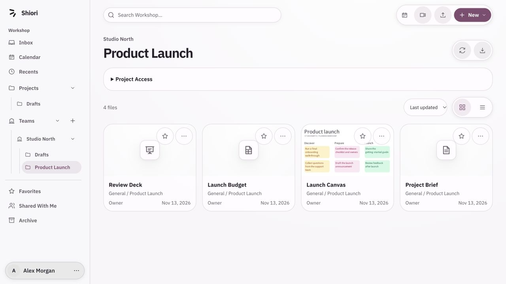

  
  <h1>Shiori</h1>
  
<strong>A self-hosted workspace for teams that plan, write, and work together.</strong>

  

    <a href="#get-started">Get Started</a> ·
    <a href="https://xiaotwu.github.io/Shiori/">User Guide</a> ·
    <a href="docs/guide/docker.md">Deploy</a> ·
    <a href="https://github.com/xiaotwu/Shiori/releases/latest">Download</a> ·
    <a href="https://github.com/xiaotwu/Shiori/issues">Report an Issue</a>
  

Shiori brings boards, documents, spreadsheets, and presentations into team-owned Projects. A team can sketch a plan on a board, write the brief, track the budget, and present a decision from the same workspace. Search and file relationships respect the access each person has.

  
  

## Workspace

- **Teams and Projects.** Give each project a home and grant access by role. Personal Projects stay under your account. Team Projects and their history stay with the team when a member leaves.
- **Work together in real time.** Collaborate on boards, write in Docs, edit cells in Sheets, and build decks in Slides. Use comments, private attachments, and named versions to review work and recover earlier content.
- **Find the source.** Search projects, people, file names, and content. Jump to the matching board object, document block, sheet cell, or slide. Team Overview shows relationships between accessible files.
- **Keep work in view.** Inbox brings team conversations, mentions, and upcoming items together. Calendar and Recents let you return to scheduled work and the files you opened.
- **Keep your data portable.** Bring in Markdown, DOCX, CSV, XLSX, and PPTX. Export supported formats or move an entire Project with its files, saved versions, and private images. [Format coverage](docs/guide/getting-started.md#docs) · [Project archives](docs/guide/project-archive.md)
- **Run it on your own infrastructure.** Docker Compose provisions the application, PostgreSQL, Redis, and SeaweedFS. Core collaboration, search, and file conversion run locally. [Deployment guide](docs/guide/docker.md)

## Get Started

Install Docker with Compose and download the Compose bundle from the [latest release](https://github.com/xiaotwu/Shiori/releases/latest). Follow the bundled `INSTALL.md` to verify the download, configure your environment, and start the published image. [Docker deployment guide](docs/guide/docker.md)

Open [localhost:8080](http://localhost:8080), create an account, and make a personal Project or a Team. Choose **New** inside a project to create a Board, Doc, Sheet, or Slide deck.

Before inviting users, set up HTTPS and verify a backup. Follow the upgrade and rollback steps for an existing deployment. [Operations and recovery](docs/guide/operations.md)

## Release Status

[Shiori v1.0.0](https://github.com/xiaotwu/Shiori/releases/tag/v1.0.0) ships a Compose bundle and a public container image for Linux ARM64 and AMD64. Both platforms passed native checks for startup, schema, sign-in, and saving and reopening a document. Acceptance of the pilot's HTTPS ingress and offsite recovery remains in progress. Meeting media requires separate setup and verification. [Pilot acceptance](docs/guide/pilot-acceptance.md) · [Meetings guide](docs/guide/meetings.md) · [Product plan](PRODUCT_PLAN.md)

## Documentation

| Guide | What it covers |
| --- | --- |
| [Using Shiori](docs/guide/getting-started.md) | Teams, Projects, the editors, relationships, and search |
| [Board Assistant](docs/guide/board-assistant.md) | Configure a model, review a draft, and apply it to a board |
| [Project branches and sync](docs/guide/project-sync.md) | Link a personal Project to a Team, create a branch, or restore a snapshot |
| [Move a project](docs/guide/project-archive.md) | Export and recover project content on another instance |
| [Deploy with Docker](docs/guide/docker.md) | Services, storage, and deployment configuration |
| [Operations and recovery](docs/guide/operations.md) | Health checks, upgrades, backups, recovery, and troubleshooting |

## Contributing

The frontend uses React and TypeScript, with a Go API and worker. The [development setup](docs/guide/getting-started.md#development-setup) covers the local services and toolchain. Report reproducible issues with the revision, browser, and steps to reproduce, and leave credentials and private content out of reports.

Shiori is available under the [MIT License](LICENSE).
